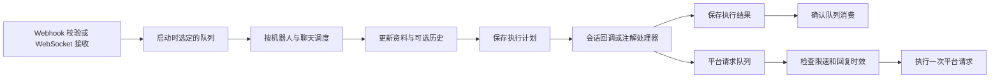

# 架构与执行规则

本页说明事件怎样进入框架、重启后怎样恢复，以及数据和执行状态如何保存。部署配置见 [配置与部署](deployment.md)，插件用法见 [插件开发](plugins.md)。

## 事件流程

聊天键包含 AppID、环境、场景和聊天标识。`guildId` 只提供频道上下文，不参与聊天键，缺少频道资料时仍使用同一执行通道。各机器人的并发额度分别计算，同一聊天中排队等待的任务不占用正在执行的额度。

### 接收确认

Webhook 校验原始字节的 Ed25519 签名，成功入队后返回 opcode 12。队列满或后端不可用时返回 503。opcode 13 挑战验证按平台协议计算签名，不作为业务事件入队。请求体最大为 2 MiB。

WebSocket 控制帧和心跳独立于插件线程。每个分片保存 session 和最后成功入队的序号。入队失败时断开连接，从前一个已接受的位置恢复；使用内存队列的新进程不会沿用旧进程的恢复位置。

同一网关实例至少间隔 5.5 秒发送一次 Identify，且不超过平台返回的 `remaining` 配额。遇到授权、`intents` 等不可恢复的关闭码时，连接停止，健康状态变为 `DOWN`。

## 队列与恢复

Redis 队列使用 Streams 消费组、待确认列表和 Lua 原子容量检查。容量包含所有未确认条目。处理结果成功写入后才执行 `XACK`、`XDEL`，未确认条目不会被裁剪。

恢复时先读取待确认列表，再处理新条目。断连后重新扫描可能已投递但响应丢失的条目，排除本进程仍在执行的任务。

启动时 Redis 不可用，框架选择内存队列。运行期间保持选定的后端。Redis 故障会暂停新的处理器和平台调用，已经进入插件的方法可以完成；后端恢复后继续。内存队列的任务无法在异常退出后恢复。

### 执行权与租约

同一个框架数据库只允许一个进程执行。数据库租约失效后，健康状态变为 `DOWN`，接收和后续业务执行停止，需要重启。

Redis namespace 也持有独占租约，防止使用不同数据库的进程共用消费组。连接恢复后，进程可以重新取得尚未被占用的 namespace；若已被其他进程接管，当前进程保持隔离状态。

## 处理器执行状态

接收确认只表示事件已被框架接受，插件业务可能尚未完成。执行计划按优先级、插件 ID、处理器 ID 固定顺序。

| 状态 | 含义 |
| --- | --- |
| `PENDING` | 等待执行 |
| `STARTED` | 已记录开始状态，即将或正在调用 |
| `SUCCESS` | 执行成功，继续传递事件 |
| `SUCCESS_BLOCK` | 执行成功并阻止后续普通处理器 |
| `FAILED` | 执行失败 |
| `SKIPPED_BLOCKED` | 被前面的成功阻断规则跳过 |
| `SKIPPED_UNAVAILABLE` | 处理器不可用，已跳过 |
| `INTERRUPTED` | 重启时发现遗留的 `STARTED` 状态 |

执行前先将 `PENDING` 改为 `STARTED`，结果随后保存。重启只执行仍为 `PENDING` 的处理器，遗留的 `STARTED` 标为 `INTERRUPTED`。成功阻断的记录也会保留，恢复后继续遵守该规则。

插件异常交给 `onError`，其他普通处理器仍可继续。异步结果由虚拟线程等待，业务异常不会触发重试。会话回调有独立执行计划，默认独占匹配的回复；回调丢失或进程重启后不会重跑。

## 平台请求

平台请求先保存开始状态，再执行 HTTP。成功、失败和结果不明的请求均不自动重发；后续可以重试状态写入和队列消费确认。

平台拒绝时，异常保留 HTTP 状态码、平台错误码、`traceId` 和 `outcomeKnown`。网络错误的 `outcomeKnown` 为 `false`，插件可按业务需要决定是否发起新请求。

消息按聊天依次发送，管理接口和其他聊天使用各自的执行通道。每个请求需满足接口频率、主动消息额度、目标用户或群额度、每日额度和配置预算。等待时保持 `PENDING`，获准发送前才记录 `STARTED`；只有实际发送的 HTTP 请求占用并发额度。

每日计数、已使用子频道集合、短期窗口和平台冷却均保存到数据库。失败或结果不明的调用保留已扣减额度，重启也不会清零。完整规则见 [接口限速与配额](rate-limits.md)。

### 被动回复

入队前和发送前检查回复时效：群聊、频道和频道私信默认 5 分钟，单聊 60 分钟。群聊和单聊在数据库中分配回复序号，分别最多 5 次、4 次。分配后即使发送失败也不回退。

高级 `raw`、`call` 调用需要插件提供自己的业务序号和回复时效信息。普通回复建议使用 `Messaging.reply`。

## 身份与资料

平台身份保留原始字符串，数据库键由带长度分隔的信息计算 SHA-256。标识类型包括 `member_openid`、`user_openid`、`guild_user_id`、`group_openid`、`guild_id`、`channel_id`。缺少可靠映射时，各场景用户分别保存。

`profiles` 保存平台资料、来源和观察时间；`members` 保存聊天内的成员关系、角色、昵称和加入时间。群内角色不会覆盖用户的全局资料，空值或未提供字段不会覆盖已知值。部分资料的 `complete` 为 `false`，`fields` 为空表示尚无已知资料。

`union_links` 只在开启共享范围且收到非空 union 值时更新，用户与群按实体类型分别保存。`related` 返回当前配置允许、处于同一共享范围的身份，结果包含查询身份自身。空 union 值不会删除此前有效关联。

metadata 主键包含插件 ID，插件上下文只允许访问自己的命名空间。普通资料、成员和关系查询限于当前机器人，跨机器人查询通过受配置限制的 `related` 完成。分页 `hasMore` 表示本地仍有下一页，不能证明平台成员名单完整。

## 数据库升级与清理

SQLite、PostgreSQL 和 MySQL 使用同一查询服务，各自提供 V1～V4 脚本：

| 版本 | 内容 |
| --- | --- |
| V1 | 框架基础表 |
| V2 | 消息索引别名、撤回来源和清理时间 |
| V3 | 独立事件归档 |
| V4 | 平台请求配额、短期窗口和冷却计数 |

启动时升级框架自己的版本表，遇到未知的更高版本会拒绝启动。升级不读取、迁移或删除旧项目数据库。

维护任务在启动一分钟后首次执行，之后每 60 分钟运行。消息历史和事件归档分别按配置保留期清理，`0` 表示长期保留。完成的执行记录和平台请求结果保留 30 天，未完成记录不按年龄删除。回复序号从首次分配起保留 24 小时，超过最长被动回复时效。

历史保存正文、消息段、类型化内容、附件元信息和处理状态；附件不自动下载。撤回记录保留原文，通知先到时建立占位记录。索引、上下文和撤回来源见 [消息历史](history.md)。

报文归档在接收校验通过后、入队前保存，重复推送分别记录。解析失败和未知事件保留原报文；归档开启后，写入失败的业务事件不返回接收确认。详见 [事件与报文归档](events.md)。

## 会话、任务与插件资源

会话键包含机器人、场景、聊天和用户，一个键只能有一个活动会话。`await` 注册后返回，下一条匹配消息调用后续回调。到期、显式取消、插件停用或进程退出后，会话结束。

定时任务支持一次延时、固定周期和六字段 Cron，默认时区为 `Asia/Shanghai`，同一任务不会重叠。重启后由插件重新注册，不补跑停机期间的周期，也不恢复临时延时任务。

初始化期间暂存会话、任务和 HTTP 路由，`onEnable` 完成后才提交注册。会话和延时任务从激活时开始计时。启用失败会撤销活动标记、暂存和已提交的注册、服务及权限节点。旧上下文在停用或下一次启用后不能继续注册资源。

HTTP 路由共享应用端口，停用时先注销入口，再等待正在处理的请求结束。响应等待上限为 30 秒，超时后仍等待插件实际结束，不自动重试。接口用法见 [插件 HTTP 路由](http.md)。
